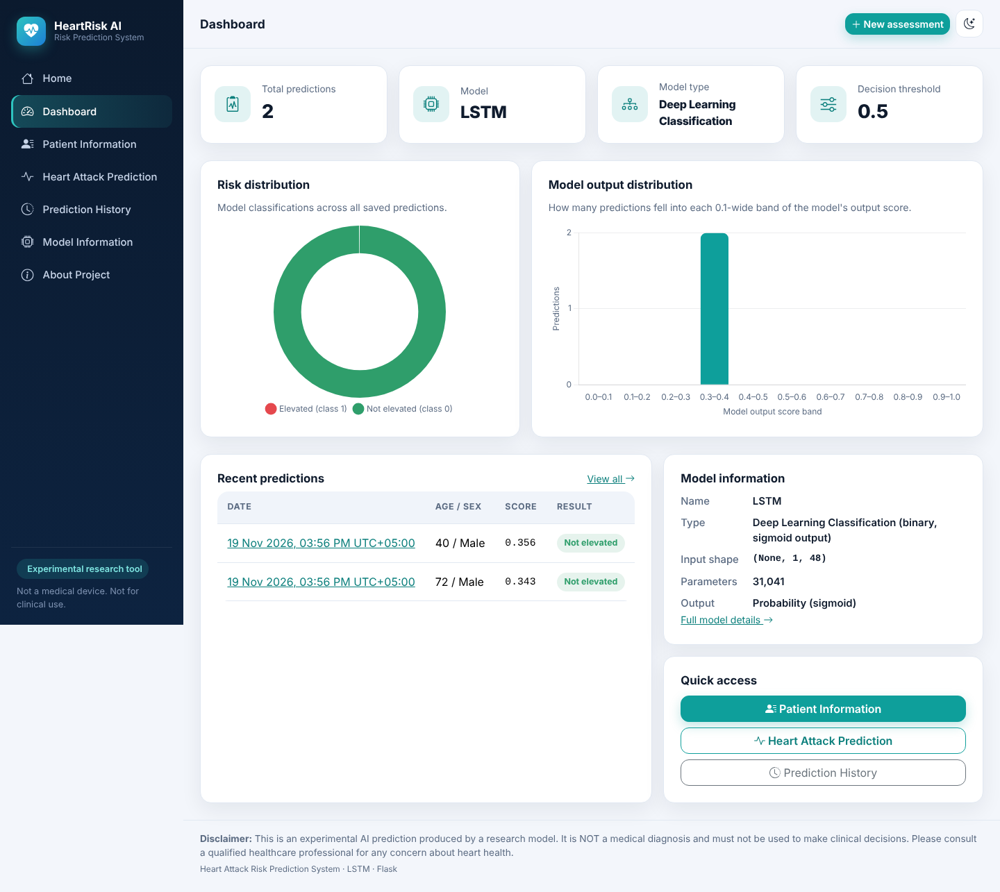
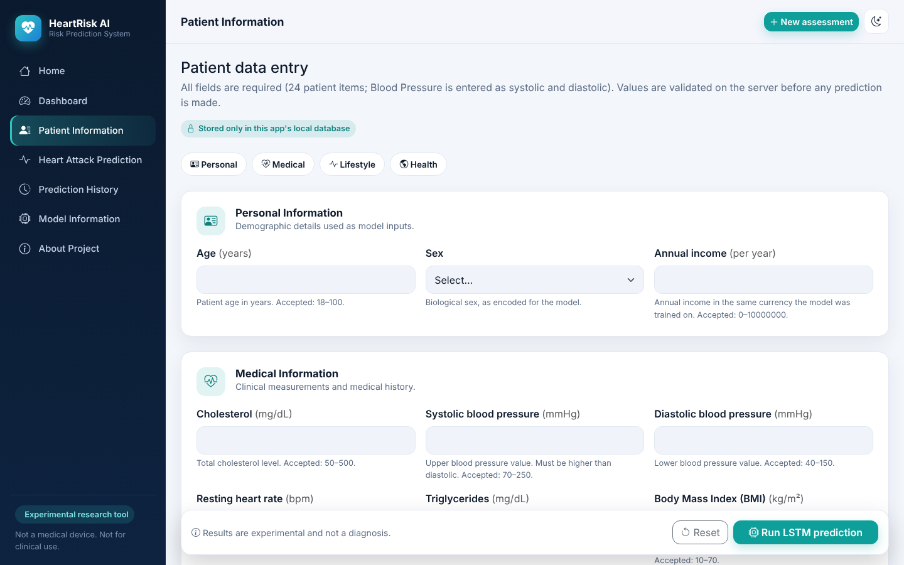
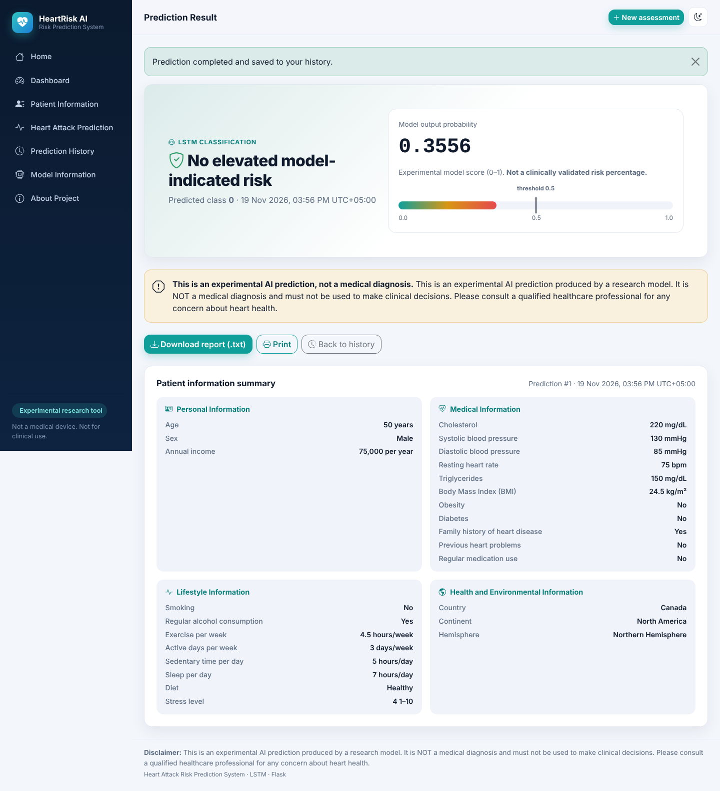
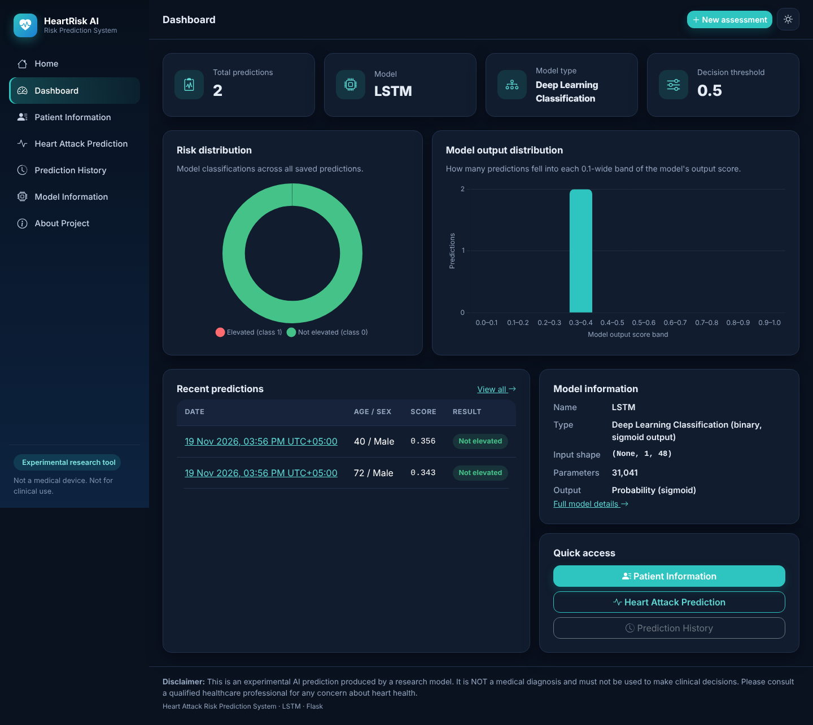
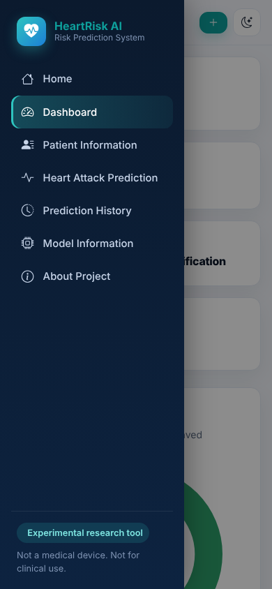

# Heart Attack Risk Prediction System

A Flask web application that serves an existing **LSTM deep learning classifier** through a validated clinical-data form, with saved prediction history, interactive charts, downloadable reports, and a dark/light healthcare-style interface.

> **Research use only.** Outputs are experimental AI predictions. They are **not medical diagnoses**, are **not clinically validated risk percentages**, and must not be used for clinical decisions. Always seek professional medical evaluation.



| Patient information | Prediction result |
|---|---|
|  |  |

| Dashboard (dark theme) | Phone layout |
|---|---|
|  |  |

More screens: [Home](static/images/home.png) · [Prediction hub](static/images/prediction.png) · [History](static/images/history.png) · [Model information](static/images/model-info.png) · [Result, dark theme](static/images/result-dark.png)

Screenshots use sample inputs and are not patient data.

---

## Features

- **Home, Dashboard, Patient Information, Heart Attack Prediction, Prediction Results, Prediction History, Model Information, About Project** pages.
- **24 patient items** (25 model inputs; Blood Pressure is entered as systolic and diastolic), grouped into four sections, with dropdowns, number fields, Yes/No toggles, help text, and client- and server-side validation.
- **Prediction workflow** uses your existing `preprocessor.pkl` and `lstm_model.keras` unchanged: the same 25 features in the same order, the same preprocessing, the same `(samples, 1, 48)` reshape, and the same 0.5 threshold.
- **Results page** shows the model output score, a threshold gauge, the classification, the patient summary, the date and time, and a visible disclaimer.
- **Downloadable plain-text report** for each prediction.
- **Prediction history** with per-record view, download, and confirmed delete.
- **Dashboard** with total predictions, risk distribution (doughnut), output distribution (bar), recent predictions, and model information.
- **Dark and light themes** that follow the system setting and can be switched manually.
- **Responsive** layout for desktop, tablet, and phone, with a collapsible sidebar.
- **Security basics:** CSRF tokens on every form POST, server-side validation, request size limit, security headers, no user-controlled file paths.
- **Model loaded once** at process start and shared across requests.
- **No invented metrics.** The app shows no accuracy or AUC values, because none were supplied with the model artifacts.

## Technology stack

| Layer | Tools |
|---|---|
| Frontend | HTML5, CSS3, JavaScript, Bootstrap 5.3, Bootstrap Icons, Chart.js 4.4, Inter font |
| Backend | Python 3.13, Flask 3.1, Werkzeug, Gunicorn |
| ML | TensorFlow / Keras 2.21 (CPU), scikit-learn 1.6.1, Pandas 3.0, NumPy 2.5 |
| Storage | SQLite (Python standard library) |
| Deployment | GitHub, Render (or any Gunicorn-compatible host) |

## Model architecture

Verified by loading `lstm_model.keras` and `preprocessor.pkl` (the app also reports these at `/model-info`):

**Preprocessing (`preprocessor.pkl`, a scikit-learn `ColumnTransformer`)**

| Step | Columns | Output |
|---|---|---|
| `StandardScaler` | 20 numeric (Age, Cholesterol, Heart Rate, Diabetes, Family History, Smoking, Obesity, Alcohol Consumption, Exercise Hours Per Week, Previous Heart Problems, Medication Use, Stress Level, Sedentary Hours Per Day, Income, BMI, Triglycerides, Physical Activity Days Per Week, Sleep Hours Per Day, Systolic BP, Diastolic BP) | 20 |
| `OneHotEncoder(drop="first")` | 5 categorical (Sex, Diet, Country, Continent, Hemisphere) | 28 |
| **Total** | 25 raw features | **48 values** |

**LSTM network (`lstm_model.keras`)**

| Layer | Output shape | Parameters |
|---|---|---|
| LSTM (64 units, tanh) | (None, 64) | 28,928 |
| Dropout | (None, 64) | 0 |
| Dense (32 units, ReLU) | (None, 32) | 2,080 |
| Dropout | (None, 32) | 0 |
| Dense (1 unit, sigmoid) | (None, 1) | 33 |
| **Total** | | **31,041** |

Input shape: `(None, 1, 48)`. Output: a score between 0 and 1. Score > 0.5 is classified as class 1 (elevated model-indicated risk).

## Prediction workflow

1. The user enters the patient's values on **Patient Information**.
2. `POST /predict` checks the CSRF token and validates every field.
3. The values are placed in a one-row DataFrame with the original 25 feature names.
4. `preprocessor.pkl` transforms them into 48 values.
5. The values are reshaped to `(1, 1, 48)`.
6. `lstm_model.keras` returns a score; score > 0.5 gives class 1.
7. The result is saved to SQLite and the user is redirected to `/result/<id>`.

## Project structure

```
heart-attack-prediction/
├── app.py                  # Flask routes, CSRF, error handling, app factory
├── app_lstm.py             # LSTM inference (original logic, see "Changes from original")
├── lstm_model.keras        # Trained LSTM model (your file, unchanged)
├── preprocessor.pkl        # Trained preprocessing pipeline (your file, unchanged)
├── requirements.txt        # Pinned dependencies
├── Procfile                # Process command for Render / Heroku-style hosts
├── gunicorn.conf.py        # Gunicorn settings
├── .python-version         # Python 3.13 (used by Render and pyenv)
├── .env.example            # Environment variable template
├── .gitignore
├── README.md
├── templates/
│   ├── base.html           # Layout, sidebar, theme toggle, footer disclaimer
│   ├── index.html          # Home
│   ├── dashboard.html      # Dashboard
│   ├── patient_info.html   # Patient Information form
│   ├── prediction.html     # Heart Attack Prediction hub
│   ├── result.html         # Prediction Results
│   ├── history.html        # Prediction History
│   ├── model_info.html     # Model Information
│   ├── about.html          # About Project
│   └── error.html          # Error pages
├── static/
│   ├── css/style.css       # Theme tokens, components, responsive rules
│   ├── js/script.js        # Theme, sidebar, validation, charts
│   └── images/             # Screenshots for this README
├── utils/
│   ├── __init__.py
│   └── helpers.py          # Form definition, validation, SQLite, reports, model info
├── tests/
│   └── test_app.py         # 23 unit and integration tests
└── instance/
    ├── .gitkeep
    └── predictions.db      # Created automatically on first run; NOT in Git
```

## Installation (Windows, macOS, or Linux)

Requirements: Python 3.13 and pip. TensorFlow 2.21 needs a 64-bit Python.

**Windows (PowerShell or Command Prompt)**

```bat
cd path\to\heart-attack-prediction
py -3.13 -m venv .venv
.venv\Scripts\activate
python -m pip install --upgrade pip
pip install -r requirements.txt
python app.py
```

Open **http://127.0.0.1:5000** in your browser.

**macOS / Linux**

```bash
cd heart-attack-prediction
python3.13 -m venv .venv
source .venv/bin/activate
pip install -r requirements.txt
python app.py
```

Notes:

- The first start takes a few seconds while TensorFlow loads the model. The console prints informational TensorFlow messages; they are not errors.
- Check `http://127.0.0.1:5000/health`. It should report `"model_loaded": true`.
- Use `python app.py`, not Gunicorn, for local development. Gunicorn does not run on Windows.
- Set `FLASK_DEBUG=1` only for local debugging. It is off by default.

### Configuration (optional)

| Variable | Purpose | Default |
|---|---|---|
| `SECRET_KEY` | Signs session and CSRF data. Set it in production. | Random per process |
| `DATABASE_PATH` | SQLite file location | `instance/predictions.db` |
| `PORT` | Port to listen on | `5000` locally, `10000` for Gunicorn |
| `SESSION_COOKIE_SECURE` | `1` when served over HTTPS | `0` |
| `WEB_CONCURRENCY` | Gunicorn worker processes (keep at 1: each loads the model) | `1` |
| `GUNICORN_THREADS` | Threads per worker | `4` |

On Windows (PowerShell), set variables with `$env:SECRET_KEY = "..."` before `python app.py`.

## Running the tests

```bash
python -m unittest discover -s tests -v
```

The 23 tests cover:

- **Model fidelity:** the output for the original `app_lstm.py` test patient matches the original implementation's output (`0.35555168986320496`, class 0), both directly and through the web form.
- **Feature contract:** 25 features in the original order; input shape `(None, 1, 48)`; sigmoid output; threshold 0.5.
- **Validation:** missing fields, out-of-range values, fractional whole numbers, invalid categories, non-numeric input, and systolic ≤ diastolic.
- **Web flow:** every page renders, `/health` reports the model loaded, a prediction saves and redirects, the result and report show the disclaimer, delete works, and bad tokens return 400.

## Deployment on Render

1. **Push to GitHub** (see "GitHub setup" below).
2. In Render, choose **New → Web Service** and connect the repository.
3. Use these settings:

   | Setting | Value |
   |---|---|
   | Runtime | Python |
   | Build command | `pip install -r requirements.txt` |
   | Start command | `gunicorn "app:create_app()" -c gunicorn.conf.py` |
   | Health check path | `/health` |

4. Add environment variables:
   - `SECRET_KEY`: a long random string (for example, from `python -c "import secrets; print(secrets.token_hex(32))"`).
   - `SESSION_COOKIE_SECURE`: `1`.
   - `PYTHON_VERSION`: `3.13.x` (or rely on `.python-version`).
5. Deploy and open the generated `*.onrender.com` URL.

### Deployment considerations

- **Memory:** loading TensorFlow and the model raised peak memory to about **714 MB** in testing (Linux, CPU build). That exceeds the 512 MB limit of Render's free instance, so choose a plan with at least 1 GB RAM and check the metrics after deploying.
- **Model files:** `lstm_model.keras` (~400 KB) and `preprocessor.pkl` (~3 KB) are small and are committed directly. Git LFS is not needed.
- **Data persistence:** Render's default filesystem is ephemeral. Prediction history is lost on redeploy or restart unless you attach a persistent disk and set `DATABASE_PATH` to a path on it. For multi-instance or long-term clinical-style records, move storage to a managed database.
- **Patient data:** the app stores entered values and predictions in the SQLite file. Review your privacy and data-protection obligations before entering real patient data, and never commit that file.
- **Platform support:** Gunicorn runs on Linux (Render). On Windows, use `python app.py`.

## GitHub setup

```bash
cd heart-attack-prediction
git init
git add .
git status            # confirm: no .venv/, no instance/*.db, no .env
git commit -m "Initial commit: Heart Attack Risk Prediction System"
git branch -M main
git remote add origin https://github.com/<your-user>/heart-attack-prediction.git
git push -u origin main
```

The `.gitignore` excludes virtual environments, `.env` files, databases, and generated reports. Re-check `git status` before every push.

## Changes from the original `app_lstm.py`

The model logic is unchanged. These changes were made for the web application:

- **Paths** are resolved relative to the file, so the app works from any working directory.
- **Loading** happens once through `load_artifacts()`, called at app start, rather than at import time.
- **Thread safety:** `model.predict` runs under a lock, because Keras inference is not guaranteed to be thread-safe.
- **`compile=False`** is passed to `load_model`, because only inference is performed.
- **`verbose=0`** suppresses per-call progress output.
- The original `Blood Pressure` string input is still supported.

## Limitations

- **Model behaviour on sample data.** During testing, 335 random but valid input profiles produced scores between **0.215 and 0.419**, and none exceeded the 0.5 threshold. The app reproduces the original model's outputs exactly, so this is a property of the model, not of the web layer. Verify the model's calibration and class balance against your training notebook before relying on the classification.
- **No validation metrics are shown** because none were provided. Add verified training or test metrics to `templates/model_info.html` only when you have them.
- **Input limits** in the form are plausibility guards chosen for this app. They are not the model's training-data ranges, which were not supplied.
- **Population:** the model's training population and label definition were not provided, so generalization is unknown.
- **Single-patient inference:** the prediction function reads the first row of its output, as the original did. The web app predicts one patient per request.

## Responsible use

This software is an experimental research and demonstration tool. It is not a medical device and has not been clinically validated. Any output must be interpreted by a qualified healthcare professional, and no decision about a patient's care should be based on it alone.
